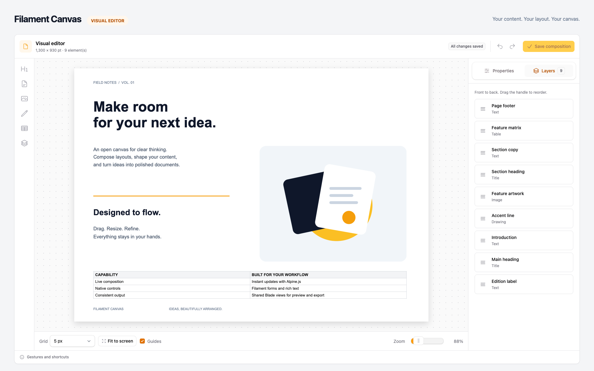
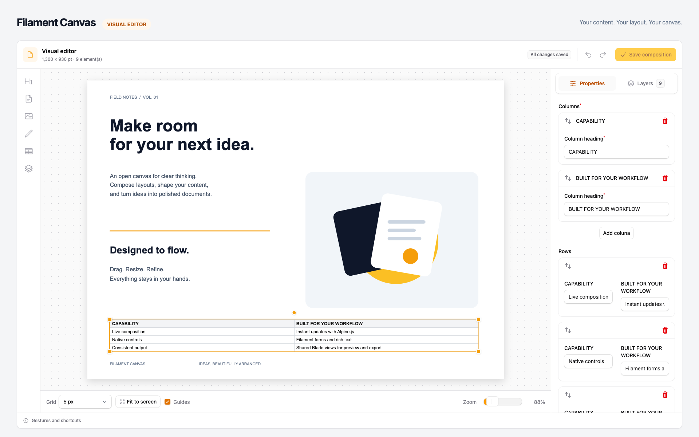
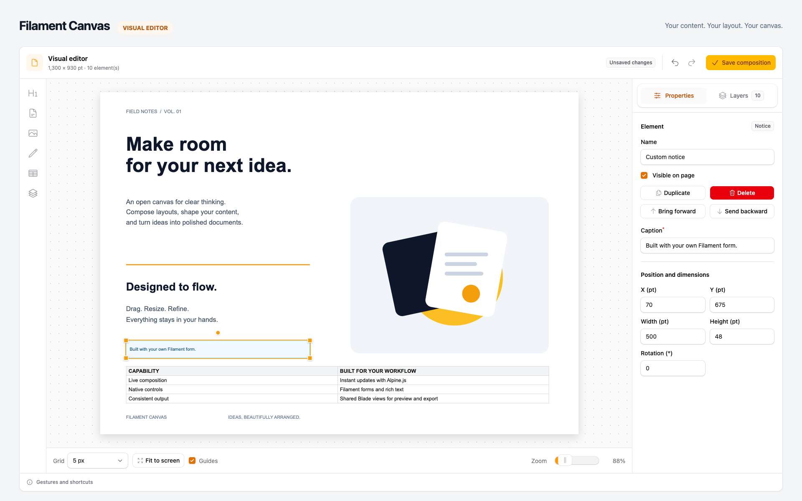
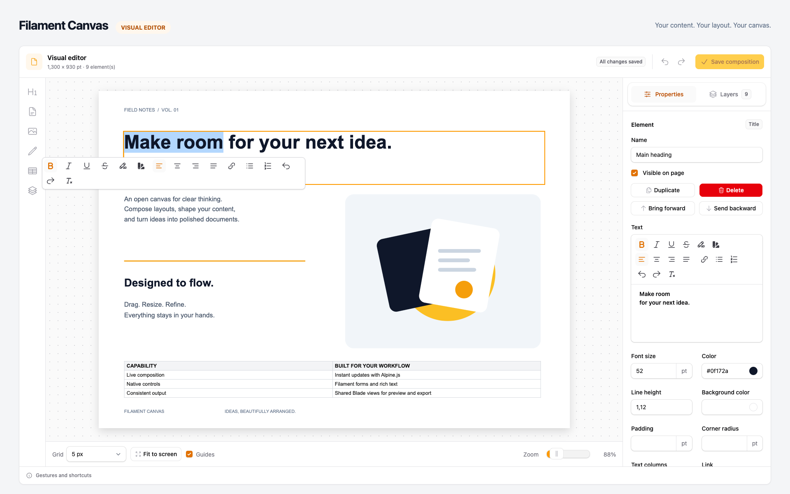

# Filament Canvas

A visual document editor for Filament PHP. Arrange text, images, drawings and tables on a canvas, edit their attributes with native Filament forms, and build your own elements with a PHP class and an Alpine Blade view.



### Features

- **Visual editing** — Drag, resize and rotate elements, zoom and pan, align with snapping guides, and manage layer order.
- **Rich text** — Edit text in the attributes panel or directly on the canvas, preserving its formatting.
- **Native Filament forms** — Define fields, defaults and validation in the element's `form()` method.
- **Reactive views** — Alpine bindings update each element locally as its values change.
- **Custom elements** — Generate a class and view with `make:canvas-element` and register them in your application.
- **Eloquent persistence** — Attach a composition to an existing model through a polymorphic relation, with revision checks when saving.
- **Media Library integration** — Select and upload images through Spatie Media Library, including authenticated access to private files.
- **Shared output** — Reuse the element views and page template for the editor preview and standalone HTML output.

## Installation

Requires PHP 8.2+, Laravel 12 or 13, Filament 5 and Livewire 4. Use a PHP version supported by your Laravel version.

```bash
composer require eduardoribeirodev/filament-canvas
```

If your application does not have Spatie Media Library's `media` table, publish its migration:

```bash
php artisan vendor:publish --provider="Spatie\MediaLibrary\MediaLibraryServiceProvider" --tag="medialibrary-migrations"
```

Run the migrations and publish Filament assets:

```bash
php artisan migrate
php artisan filament:assets
```

Register the plugin in your panel provider:

```php
use EduardoRibeiroDev\FilamentCanvas\CanvasPlugin;
use Filament\Panel;

public function panel(Panel $panel): Panel
{
    return $panel
        // Your panel configuration...
        ->plugin(CanvasPlugin::make());
}
```

The service provider and Artisan command are discovered automatically. The package creates the `canvas_elements` table; your application supplies the document model and its table.

## Configuration

Publish the configuration file:

```bash
php artisan vendor:publish --tag=filament-canvas-config
```

Defaults in [config/filament-canvas.php](config/filament-canvas.php):

```php
return [
    'elements' => [],
    'width' => 1920,
    'height' => 1080,
    'min_zoom' => 0.25,
    'max_zoom' => 3,
    'media_disk' => 'public',
    'library_collection' => 'library',
    'file_roots' => [],
];
```

| Option | Purpose |
| --- | --- |
| `elements` | Custom element classes added to the built-in registry, available to editors and model saves. |
| `width`, `height` | Default canvas dimensions in points. A model can override `canvasSize()`. |
| `min_zoom` | Minimum editor zoom as a scale (default `0.25`, or 25%). |
| `max_zoom` | Maximum editor zoom as a scale (default `3`, or 300%). |
| `media_disk` | Default disk for uploads. |
| `library_collection` | Default Spatie Media Library collection for uploads. |
| `file_roots` | Additional local directories allowed by the package's file resolver. |

Set `min_zoom` and `max_zoom` in `config/filament-canvas.php` to change the slider, wheel/pinch gestures and fit-to-screen limits. For example, `0.1` and `5` allow 10%–500%. Both must be positive, with the maximum greater than the minimum. Custom editor views must pass these values as the `minZoom` and `maxZoom` options to `canvas(...)`, as the bundled editor does.

For the public disk, run `php artisan storage:link`. You can publish the package views with `php artisan vendor:publish --tag=filament-canvas-views` if you need to customize the editor interface.

## Core Components

### Document Model

Implement `CanvasOwner` and use `HasCanvas` on the model that owns the composition. Add Spatie's `HasMedia` and `InteractsWithMedia` to support uploads to that document:

```php
namespace App\Models;

use EduardoRibeiroDev\FilamentCanvas\Contracts\CanvasOwner;
use EduardoRibeiroDev\FilamentCanvas\Models\Concerns\HasCanvas;
use Illuminate\Database\Eloquent\Model;
use Spatie\MediaLibrary\HasMedia;
use Spatie\MediaLibrary\InteractsWithMedia;

class Document extends Model implements CanvasOwner, HasMedia
{
    use HasCanvas;
    use InteractsWithMedia;

    public function canvasSize(): array
    {
        return [841.89, 595.28]; // A4 landscape, in points.
    }

    public function registerMediaCollections(): void
    {
        $this->addMediaCollection('library')->useDisk('public');
    }
}
```

`HasCanvas` supplies the `canvasElements()` relation and the public canvas API. Elements are stored separately from your document's other attributes.

```php
$canvas = $record->getCanvas();

$result = $record->saveCanvas(
    $blocks,
    expectedRevision: $canvas->revision,
);

$html = $record->renderCanvas();
```

`getCanvas()` returns a `CanvasDocument` containing `blocks`, `width`, `height`, `revision` and `metadata`. `saveCanvas()` returns the saved `blocks` and their new `revision`. The expected revision is required: stale writes are rejected without changing the document. Both methods accept `user: $user` for jobs or other explicit access contexts. Loading checks `view`; saving checks `update` and the model's editing restrictions.

Define shared composition settings on the model so that the editor and standalone output use the same configuration:

```php
public function canvasTemplate(): string
{
    return 'canvas.document';
}

public function canvasElementsAvailable(): array
{
    return [
        \EduardoRibeiroDev\FilamentCanvas\Elements\TextElement::class,
        \EduardoRibeiroDev\FilamentCanvas\Elements\ImageElement::class,
    ];
}
```

The default implementations return `null` to inherit existing configuration. Model settings take precedence over panel defaults; explicit page, schema or render overrides take precedence over model settings. Configure custom elements on the model to make them available to editor saves and background jobs.

Define the document's `view` and `update` policy methods. The editor checks `update` access when opening and saving, and `view` access when loading. Override `assertCanvasEditable(): void` to enforce domain restrictions such as preventing changes to published documents; throw an exception when editing must be rejected.

### Resource Editor Page

Create a page for your existing Filament resource:

```php
namespace App\Filament\Resources\Documents\Pages;

use App\Filament\Resources\Documents\DocumentResource;
use EduardoRibeiroDev\FilamentCanvas\Pages\EditCanvas;

class EditDocumentCanvas extends EditCanvas
{
    protected static string $resource = DocumentResource::class;
}
```

Register it in the resource:

```php
public static function getPages(): array
{
    return [
        'index' => Pages\ListDocuments::route('/'),
        'create' => Pages\CreateDocument::route('/create'),
        'edit' => Pages\EditDocument::route('/{record}/edit'),
        'canvas' => Pages\EditDocumentCanvas::route('/{record}/canvas'),
    ];
}
```

Link to it with `DocumentResource::getUrl('canvas', ['record' => $record])`. The page gets the model from its resource and uses that model's class name as the document type by default.

### Embedded Editor

Use the `Canvas` schema component to place the editor inside an existing resource page or schema:

```php
use App\Models\Document;
use EduardoRibeiroDev\FilamentCanvas\Schemas\Components\Canvas;

Canvas::make()
    ->record(fn (Document $record) => $record)
    ->columnSpanFull();
```

Use an existing, saved record. The canvas has its own **Save composition** action and persists its elements independently of the surrounding form.

## Canvas Elements

### Built-in Elements

| Class | Type | Includes |
| --- | --- | --- |
| `TitleElement` | `title` | Rich text with heading defaults and inline editing. |
| `TextElement` | `text` | Rich text, font size, colors, spacing, columns and links. |
| `ImageElement` | `asset` | Media selection, cropping, image fit, opacity and flipping. |
| `DrawingElement` | `drawing` | Drawing geometry, stroke and fill settings. |
| `DataTableElement` | `data-table` | Editable column headings and rows through native repeaters. |

These classes live in `EduardoRibeiroDev\FilamentCanvas\Elements` and are available by default.



### Creating Custom Elements

Generate an element in your application:

```bash
php artisan make:canvas-element Notice
```

The command asks **Which built-in element would you like to extend?** Choose **None (generic element)**, **Title**, **Text**, **Image**, **Drawing** or **Data table**.

The command creates two files:

```text
app/Canvas/Elements/Notice.php
resources/views/canvas/elements/notice.blade.php
```

Choosing **None (generic element)** generates a working field and its default value:

```php
namespace App\Canvas\Elements;

use EduardoRibeiroDev\FilamentCanvas\Elements\CanvasElement;
use Filament\Forms\Components\TextInput;
use Filament\Schemas\Schema;

class Notice extends CanvasElement
{
    public function type(): string
    {
        return 'notice';
    }

    public function getLabel(): string
    {
        return 'Notice';
    }

    public function form(Schema $schema): Schema
    {
        return $schema->components([
            TextInput::make('caption')
                ->required()
                ->rules(['string'])
                ->maxLength(255)
                ->default('New notice'),
        ]);
    }

    public function view(): string
    {
        return 'canvas.elements.notice';
    }
}
```

The generated Blade view contains a styled container and `x-text="data.caption"`. You can replace its layout while keeping the same binding:

```blade
<div style="width:100%;height:100%;padding:12px;box-sizing:border-box;font:16px/1.4 Arial,sans-serif">
    <span x-text="data.caption"></span>
</div>
```

The base class provides an icon. Register the class using one of the options below, then add it from the editor toolbar.



**Inheriting a built-in element:**

Choosing a built-in type preserves its form, icon, media settings and editing tools. The generated class overrides only its identity and view. For example, choosing **Text** for `QuoteElement` generates:

```php
namespace App\Canvas\Elements;

use EduardoRibeiroDev\FilamentCanvas\Elements\TextElement;

class QuoteElement extends TextElement
{
    public function type(): string
    {
        return 'quote';
    }

    public function getLabel(): string
    {
        return 'Quote';
    }

    public function view(): string
    {
        return 'canvas.elements.quote';
    }
}
```

Its generated view reuses the built-in markup, which you can customize:

```blade
@include('filament-canvas::elements.text')
```

The inherited form and inline rich text editor work immediately. To choose the parent without a prompt:

```bash
php artisan make:canvas-element QuoteElement --extends=text
```

`--extends` accepts `none`, `title`, `text`, `image`, `drawing` and `data-table`. With `--no-interaction` and no `--extends` option, the command generates a generic element.

**Nested elements:**

```bash
php artisan make:canvas-element Marketing/PromoCardElement
```

This creates `App\Canvas\Elements\Marketing\PromoCardElement`, with type `marketing-promo-card` and view `canvas.elements.marketing.promo-card`. The final `Element` suffix is omitted from the type and view name; the PHP class name keeps the suffix and uses PascalCase. The command also accepts fully qualified names within your application's `Canvas\Elements` namespace and respects a custom application namespace.

Existing class or view files stop generation before either file is changed. To deliberately replace both files:

```bash
php artisan make:canvas-element Notice --force
```

The command prints the registration instruction; it does not edit your configuration or panel provider.

### Registering Elements

For availability throughout your application, add the class to the published configuration:

```php
// config/filament-canvas.php
'elements' => [
    App\Canvas\Elements\Notice::class,
],
```

You can also add an element at panel level:

```php
CanvasPlugin::make()
    ->extraElements([\App\Canvas\Elements\Notice::class]);
```

To configure one resource editor page:

```php
protected static ?array $canvasExtraElements = [Notice::class];
```

Or an embedded editor:

```php
Canvas::make()
    ->record(fn (Document $record) => $record)
    ->extraElements([Notice::class]);
```

Use `elements([...])`, or the page's `$canvasElements`, to replace the available classes instead of adding to the defaults. Give each element a unique, stable `type()`, since saved compositions use it to identify the class.

If you override the owner's `canvasElementRegistry()`, include your custom classes there as well. Model saves and background jobs use the owner's registry outside the editor. Global configuration is the simplest way to share registrations when using the default `HasCanvas` implementation.

### Forms and Reactive Views

A field path is relative to the selected element's properties. `TextInput::make('caption')` reads and writes `data.properties.caption` on the stored block. In the element view, that value is available directly as the Alpine expression `data.caption`.

1. The editor loads the selected element's `form()` in the attributes panel.
2. Field changes update that element's local state.
3. Alpine bindings update its view using that state.
4. **Save composition** validates the native form rules and persists the composition.

No PHP variables need to be passed to an element view. Blade supplies the reusable markup; Alpine supplies the changing values. Each element instance gets its own `data` scope. Document metadata supplied by `canvasMetadata()` is available in that scope in both the editor and standalone output. Element properties take precedence. Metadata is transient and is not saved in the element properties.

Keep presentation calculations in the element's Blade view using CSS, Alpine getters and `x-data`. The same view runs in the editor and exported document, so it needs no separate display adapter. Native Repeaters can manage item lists in `form()`.

Custom text or image views can mark their displayed content with `data-canvas-text` or `data-canvas-image`. This lets the package's inline text and crop tools read the content shown by the view.

```blade
<span x-text="data.caption"></span>

<div :style="{ color: data.color, fontSize: data.font_size + 'px' }">
    <span x-text="data.caption"></span>
</div>

<template x-for="(item, index) in (data.items ?? [])" :key="index">
    <span x-text="item.label"></span>
</template>
```

Declare `color`, `font_size` and `items` in `form()` before using them in your own element. Defaults initialize new elements. Use native field rules such as `required()`, `maxLength()`, `numeric()` and `rules()` for validation.

Use `x-text` for plain strings. Use `x-html` only with sanitized HTML, such as the built-in text element's prepared rich text. Avoid `{{ $caption }}` or `@foreach` for changing element values, since those run when the template is compiled.

Visual updates do not require a rendering request for each change. Selecting an element can load its form, fields with server-dependent behavior can make Livewire requests, and saving or uploading still uses the server.

### Extending Built-in Elements

Extend a built-in class when your element needs its existing behavior. For example, a custom text element inherits rich text and double-click inline editing:

```php
use EduardoRibeiroDev\FilamentCanvas\Elements\TextElement;

class QuoteElement extends TextElement
{
    public function type(): string
    {
        return 'quote';
    }

    public function getLabel(): string
    {
        return 'Quote';
    }
}
```

You can override `view()` or extend `form()` to add fields. Extending `CanvasElement` gives you a generic element; using a text field alone does not enable inline rich text editing. `ImageElement` and `DrawingElement` similarly provide their respective editing tools through inheritance.

## User Interactions

- Use the toolbar to insert an element, then drag it or use the resize and rotation handles.
- Edit content and appearance in **Properties**. Position and dimensions are managed separately from element properties.
- Double-click a text element to edit it in place. Use the floating toolbar for formatting.
- Open **Layers** to select and reorder elements. Visibility and duplication are available in the attributes panel.
- Use the grid, snapping controls, zoom and **Fit to screen** to work at different scales.
- Use the undo and redo buttons, or `Ctrl/Cmd+Z` and `Ctrl/Cmd+Shift+Z` while the canvas has focus.
- Click **Save composition** to persist changes. Unsaved changes remain local to the editor.



## Advanced Features

### Media Collections

`ImageElement` already declares an `image` collection with `image_id` as its reference field. Custom elements can declare collections through `mediaCollections()`:

```php
public function mediaCollections(): array
{
    return [
        'image' => [
            'label' => 'Image',
            'accepted_mime_types' => ['image/png', 'image/jpeg', 'image/webp'],
            'max_files' => 1,
            'max_size' => 10240, // Kilobytes.
            'reference_field' => 'image_id',
        ],
    ];
}
```

The media library validates file access and references before saving. Uploads use the owning document by default, so it must implement Spatie's `HasMedia` contract. Private media uses signed, authenticated file URLs.

Collections can customize `disk`, `query`, `authorize`, `upload_owner` and `upload_collection`. Use these when media belongs to a different model or needs application-specific access rules. The package prepares browser or output URLs from the saved media references; element views bind to the resulting data.

### Page Templates and Output

Select the page layout on the plugin, editor page or embedded editor:

```php
CanvasPlugin::make()->template('canvas.page');
```

```php
protected static ?string $canvasTemplate = 'canvas.page';
```

```php
Canvas::make()
    ->record(fn (Document $record) => $record)
    ->template('canvas.page');
```

A page template receives the positioned `$blocks`, document `$data`, `$width`, `$height` and `$preview`. Start with the [default page template](resources/views/templates/blank.blade.php), preserving its positioning and element styles. To reuse it from your own view:

```blade
{{-- resources/views/canvas/page.blade.php --}}
@include('filament-canvas::templates.blank')
```

Copy the default template's markup and styles into your view when you want to change the layout. Page templates use PHP for document-level layout; element views use Alpine for their changing values. An owner can implement `Contracts\CanvasRenderData` to supply additional page data through `canvasRenderData(CanvasDocument $document, EditorContext $context): array`.

For standalone output, models using `HasCanvas` can render their saved canvas directly:

```php
$html = $record->renderCanvas();

// Override the page template for this render.
$html = $record->renderCanvas('canvas.page');

// Use an explicit user, for example in a queued job.
$html = $record->renderCanvas(user: $user);
```

The method loads the saved document and checks the `view` and `update` policies. It uses the current authenticated user unless one is supplied. Model template and element settings apply both within and outside a Filament panel. Unspecified settings inherit panel or package defaults. Templates and elements configured only on an editor page or schema component are not automatically inherited. The model must already be saved. The older store and context APIs remain available for custom storage integrations; ordinary Eloquent usage goes through the model methods.

Standalone HTML includes Alpine and the prepared element values. If a Chromium-based exporter prints the HTML, wait until `window.canvasReady === true`; inspect `window.canvasError` if preparation fails. PDF generation itself belongs to your application.

### Translations

The editor follows Laravel's current locale. Included locales are `de`, `en`, `es`, `fr`, `it`, `pt_BR` and `pt_PT`, covering element forms, toolbar labels, media controls, help text and editor messages.

```php
app()->setLocale('pt_BR');
```

To customize the translations, publish the language files:

```bash
php artisan vendor:publish --tag=filament-canvas-translations
```

Edit `lang/vendor/filament-canvas/{locale}/canvas.php` in your application. Custom elements should translate their own labels using Laravel's `__()` helper. Saved user content and custom collection labels are preserved as supplied by the application.

### Custom Storage

Implement `Contracts\DocumentStore` when documents live outside the default Eloquent relation. The contract defines `authorize()`, `load()` and `save()`; saving must compare the expected revision and persist changes atomically.

```php
CanvasPlugin::make()
    ->documentStore('presentation', PresentationStore::class);
```

Then use `Canvas::make()->document('presentation', $id)` in a schema. See [JsonDocumentStore](src/Examples/JsonDocumentStore.php) for a file-based example that uses a lock and revision checking. It requires an application-defined `canvas-document` authorization gate.

## Data Structure

A composition is an ordered array of blocks. For the generated Notice element:

```php
[
    'type' => 'notice',
    'data' => [
        'name' => 'Notice',
        'x_pt' => 20,
        'y_pt' => 30,
        'width_pt' => 240,
        'height_pt' => 50,
        'rotation_deg' => 0,
        'visible' => true,
        'properties' => [
            'caption' => 'New notice',
        ],
    ],
]
```

- `type` identifies the registered element class.
- `data` contains its name, geometry, visibility and optional media references.
- `data.properties` contains the values declared by its form.
- Array order defines the layer order. Persistence adds the element ID and layer index.

Geometry uses points, displayed as one CSS pixel per point before editor zoom. Image references such as `image_id` belong to the outer `data` envelope. Text elements store the native RichEditor document in `properties.rich_text`; their HTML and plain text are derived output values.

The view's Alpine `data` scope contains the flattened properties plus prepared values such as `type`, `geometry` and `media`. It is the display state for one element, rather than the stored block envelope.

## Method Reference

### Element Methods

| Method | Purpose |
| --- | --- |
| `type(): string` | Stable identifier used in saved blocks. Required. |
| `getLabel()` | Display name in the toolbar and attributes panel. Required. |
| `view(): string` | Name of the reactive Blade view. Required. |
| `form(Schema $schema): Schema` | Native attribute fields, defaults and validation. Empty by default. |
| `getIcon()` | Toolbar icon. The base class provides a default. |
| `showInToolbar(): bool` | Whether users can insert the type from the toolbar. Defaults to `true`. |
| `mediaCollections(): array` | Media policies and reference fields. Empty by default. |
| `normalize(array $properties): array` | Optional derivation of stored output values. Returns properties unchanged by default. |

A typical custom element needs only `type()`, `getLabel()`, `form()` and `view()`.

### Editor Configuration

| Scope | Add elements | Replace elements | Page layout | Editor interface |
| --- | --- | --- | --- | --- |
| Panel plugin | `extraElements([...])` | `elements([...])` | `template('view')` | `editorView('view')` |
| Resource page | `$canvasExtraElements` | `$canvasElements` | `$canvasTemplate` | `$canvasEditorView` |
| Schema component | `extraElements([...])` | `elements([...])` | `template('view')` | `editorView('view')` |

## Development

```bash
composer install
npm ci
npm run build
npm test
vendor/bin/phpunit
```

Vite builds JavaScript and editor CSS to `resources/dist`, preserving `canvas.js` as an ES module and `document.js` as a standalone IIFE bundle. Run `php artisan filament:assets` in the consuming application after rebuilding package assets.

Documentation screenshots are real captures of the editor using isolated sample content. The custom-element screenshot uses the files generated by `make:canvas-element Notice`.

## License

The MIT License (MIT). See [LICENSE](LICENSE) for details.

## Credits

- Built for [Filament](https://filamentphp.com)
- Created by [Eduardo Ribeiro](https://github.com/eduardoribeirodev)

## Support

For issues, questions, or contributions, please visit the [GitHub repository](https://github.com/eduardoribeirodev/filament-canvas). Don't forget, Jesus loves you ❤️.
